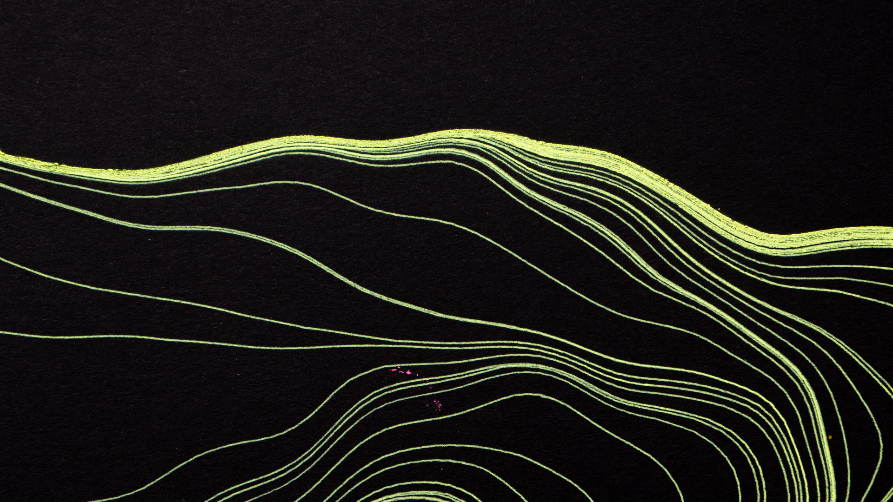
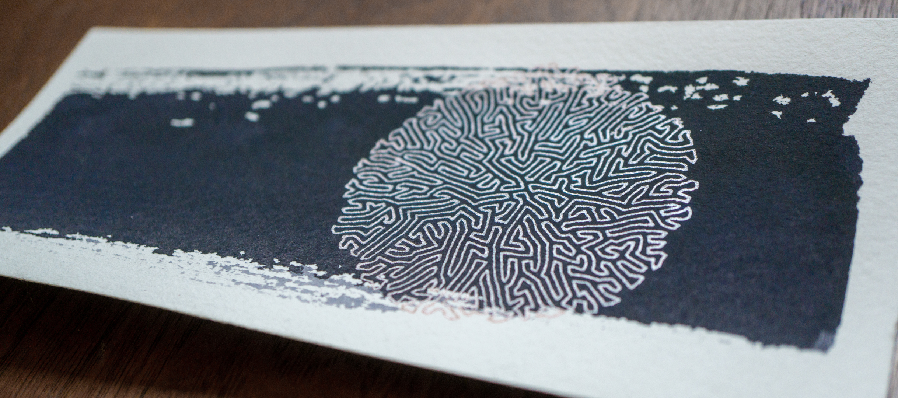
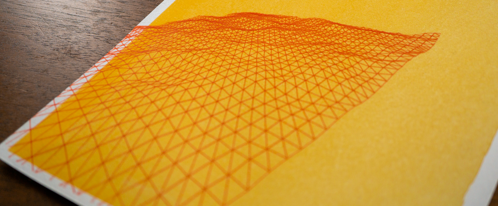
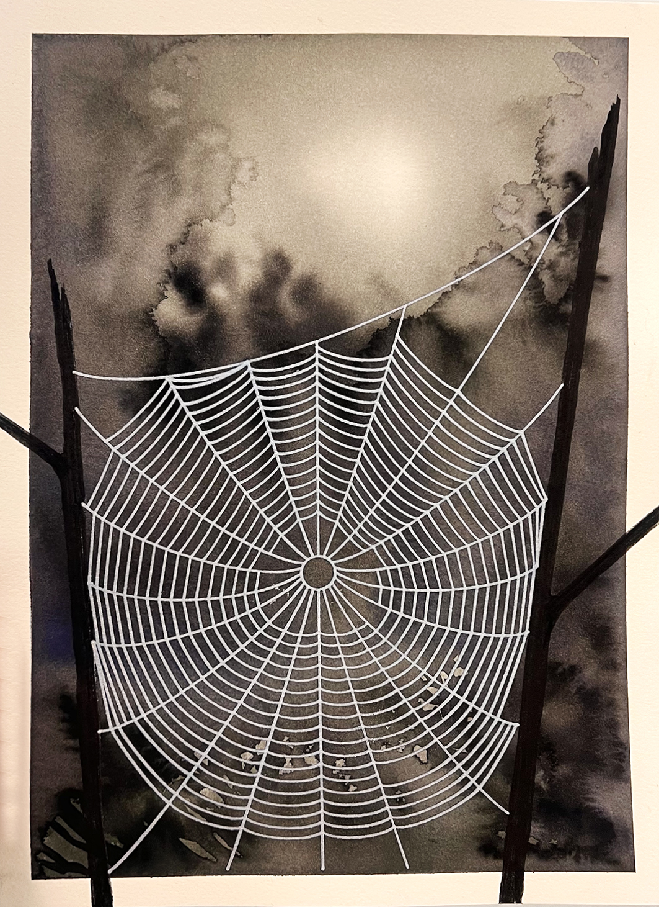
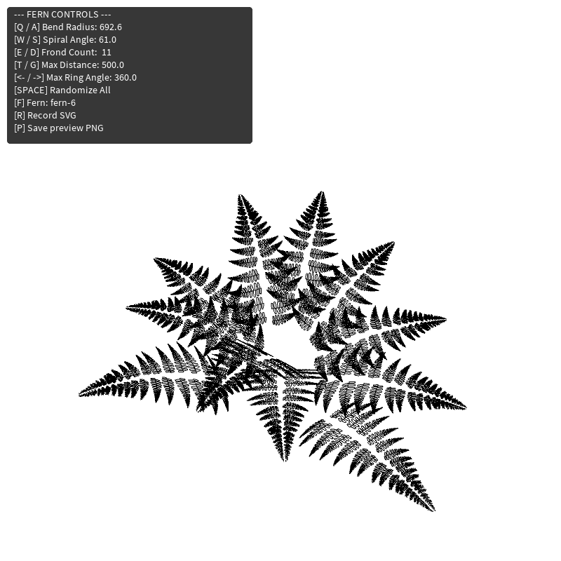

# processing experiments

My generative art sketches written in Processing (Java). Most generate SVG artwork for pen plotting with an [AxiDraw](https://axidraw.com/). Sketch-specific keyboard controls are listed below.

## Running the sketches

Install [Processing](https://processing.org/download/), then open the folder for a sketch in Processing and run its main `.pde` file (the one with the same name as the folder). Each sketch runs independently.

## Sketches

### Flow field
Press **S** to export an SVG; use **Up/Down** to increase or decrease the number of path steps.

  

### Differential line growth
Press **S** to export the current line as an SVG, or **R** to start a new line.

  

### Drift
- Move the mouse to rotate the view.
- Press **R** to export an SVG.
- **+/-** to change noise octaves.
- **[/]** to decrease/increase the height displacement.

  

### Arachne
Press **R** to export an SVG, **Up/Down** to adjust droop, and **[/]** to decrease/increase web spacing.

  

### 3D fern
- Move the mouse to rotate the view.
- Press **F** to cycle fern source files.
- **R** to export an SVG, and **P** to save a preview PNG.
- **Space** randomizes parameters
- **Q/A** adjusts bend radius
- **W/S** spiral angle
- **E/D** frond count
- **T/G** distance
- **Left/Right** ring angle

  

